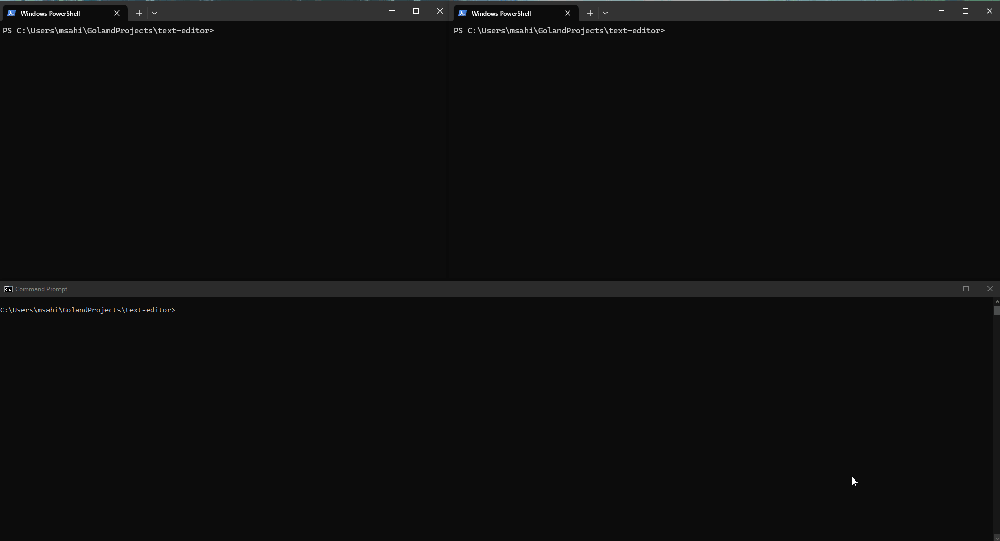

<h2>Real-Time Collaborative Text Editor</h2>



<h3>Overview</h3>

This project is a real-time collaborative text editor that allows multiple users to edit a document simultaneously. It uses WOOT CRDT (WithOut Operational Transformation) for conflict-free editing, ensuring a consistent document state across distributed users.

Features<ul>
<li>Real-time collaboration: Multiple users can edit the same document.</li>
<li>Conflict-free: Utilizes the WOOT CRDT algorithm so concurrent edits converge to the same document on every client, in any delivery order. The server only relays edits; it does not resolve conflicts.</li>
<li>Terminal-based: Built using Termbox for a command-line interface.</li>
<li>File loading and saving: Easily load and save files within the editor.</li>
</ul>
Installation
<br>
Clone the repository:
<br>

```
git clone https://github.com/msahilk/text-editor.git
```

Run a server instance (locally or in the cloud):

```
cd text-editor
./server.exe
```


Connect to the server with one or more clients! You can use the following flags when connecting:
<ul>
<li>-debug: enable debug logging</li>
<li>-file: filename to save from/load to (default save is "editor-content.txt") </li>
<li>-login: choose a custom username when joining</li>
<li>-scroll: enable scrolling in the editor</li>
<li>-server: server address (default port 8080)</li>
</ul>

```
./client.exe -server localhost:8080 -login true -file "my_file.txt"
```

How It Works <br>
The editor uses WOOT CRDT to ensure that every user's changes are applied consistently, even if they edit the same parts of the document simultaneously. Each character in the document is uniquely identified and can be inserted or deleted without conflicts.
It uses Go's concurrency and thread safety to avoid conflicts in the client-server architecture.

Each edit is sent as the CRDT character itself (its unique ID plus the IDs of the characters it was inserted between), not as a text position. Positions shift when users type at the same time, but IDs never change, so every client places the character in the same spot. Edits whose neighbours have not arrived yet are held and retried, and applying the same edit twice has no effect.

Testing <br>

Unit tests, including a randomized convergence test that simulates 2-8 users editing concurrently with edits delivered in random order:

```
go test -race ./...
```

Load test: starts the server and many headless clients that edit the same document at once, then checks that every client ended with an identical document and reports broadcast latency.

```
go build -o server.exe ./server
go build -o loadclient.exe ./loadtest/client
go run ./loadtest -clients 20 -ops 100
```
